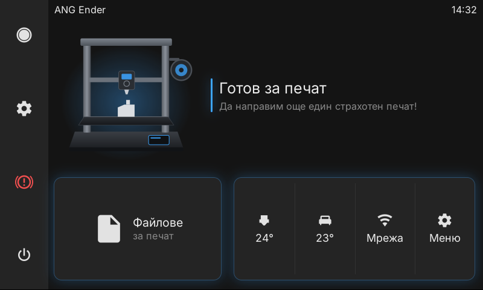
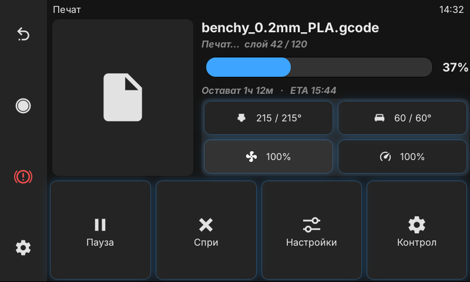

# ANG_Ender_screen

Нов потребителски интерфейс (тема + нов начален екран) за [KlipperScreen](https://github.com/KlipperScreen/KlipperScreen), вдъхновен от изчистения стил на Bambu Lab принтерите.

Целеви екран: **4.3" 800×480 HDMI тъч екран**.

## Какво има в момента
**Тема `ang-bambu`** (`styles/ang-bambu/`):
- тъмен фон `#141414`, карти `#242424` със заоблени ъгли
- син акцент `#3DA5FF` и синьо сияние около бутоните
- избран елемент: синя рамка и тъмносин фон
- иконите засега са от `material-dark` и ще бъдат заменени

**Добавка `ang_ender`** (`addons/ang_ender/`):
- изчистен начален екран: илюстрация на принтера, поздрав, карта „Файлове“ и карта със състояние (дюза, легло, мрежа, меню)
- „Меню“ отваря стандартното главно меню на KlipperScreen (Home, Движение, Калибрация…)
- зарежда се чрез вградения механизъм за добавки на KlipperScreen (`enable_addons`), без промени по кода му

## Как изглежда
Снимки 800×480 с реалния GTK CSS на темата. Това не са снимки от работещ KlipperScreen: началният екран е истинският панел с изкуствени данни, а другите три са приблизителни макети.

**Начален екран** (истинският код на панела, с изкуствени данни):



| Меню | Печат | Температура |
|---|---|---|
|  |  |  |

Прегенериране (нужни са GTK3 и Xvfb):

```bash
xvfb-run -a -s "-screen 0 800x480x24" python3 tools/preview.py ~/KlipperScreen/styles/base.css $PWD/styles/ang-bambu $PWD/docs/preview
```

## Инсталация
На Raspberry Pi-то с KlipperScreen:

```bash
cd ~ && git clone https://github.com/ageorgiev86/ANG_Ender_screen.git
```

```bash
~/ANG_Ender_screen/install.sh
```

След това в KlipperScreen:
1. **Settings → Icon Theme → ang-bambu**
2. **Settings → Enable Add-ons** (включи), после рестартирай KlipperScreen

Препоръчително за 800×480 в `KlipperScreen.conf`, секция `[main]`:

```ini
theme: ang-bambu
font_size: small
enable_addons: True
```

Обновяване:

```bash
cd ~/ANG_Ender_screen && git pull
```

## План
- [x] Тема: цветове и форми
- [ ] Собствени икони в стил Bambu
- [x] Изчистен начален екран
- [ ] Нов екран по време на печат (миниатюра, прогрес, оставащо време, слой)
- [ ] Плочки за температури и вентилатори

## Лиценз
AGPL-3.0, както KlipperScreen (иконите са производни на темата material-dark).
