# ANG_Ender_screen

Нов потребителски интерфейс (тема + нов начален екран) за [KlipperScreen](https://github.com/KlipperScreen/KlipperScreen), вдъхновен от изчистения стил на Bambu Lab принтерите.

Целеви екран: **4.3" 800×480 HDMI тъч екран**.

## Какво има в момента
**Тема `ang-bambu`** (`styles/ang-bambu/`):
- тъмен фон `#141414`, карти `#242424` със заоблени ъгли
- син акцент `#3DA5FF` и синьо сияние около бутоните
- избран елемент: синя рамка и тъмносин фон
- иконите засега са от `material-dark` и ще бъдат заменени

**Добавка `ang_ender`** (`addons/ang_ender/`), зарежда се чрез вградения механизъм за добавки на KlipperScreen (`enable_addons`), без промени по кода му:
- лява навигация: Начало · Управление · AMF · Устройство · Съобщения · авариен стоп
- страници: начало, управление, въздух, вентилатор, дюза и екструдер, температура (numpad), движение, скорост, AMF, редакция на слот, сушене, устройство, списъци (калибрация, инструменти), печат
- местата за рендери се попълват сами, щом сложиш PNG файловете — [docs/RENDERS.md](docs/RENDERS.md)
- имената на обектите в Klipper (камера, вентилатори, светлина) са в `addons/ang_ender/config.py`
- екранът по време на печат (`ang_job`) е готов, но още **не** замества стандартния — включва се в `OVERRIDES` в `addons/ang_ender/__init__.py`

## Как изглежда
Снимки 800×480 от истинския код на страниците с изкуствени данни за принтера (`tools/preview_pages.py`).
Пунктирните рамки са местата за рендерите от SolidWorks — списъкът е в [docs/RENDERS.md](docs/RENDERS.md).

| | | |
|---|---|---|
| 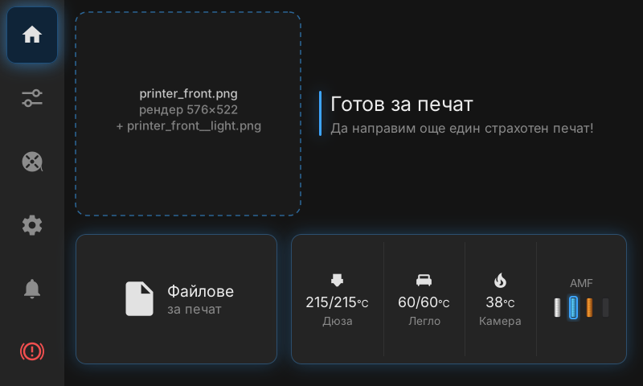 | 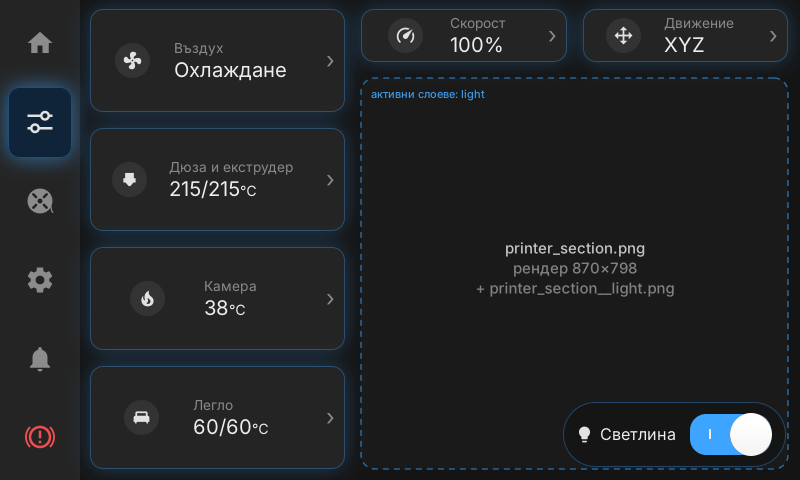 | 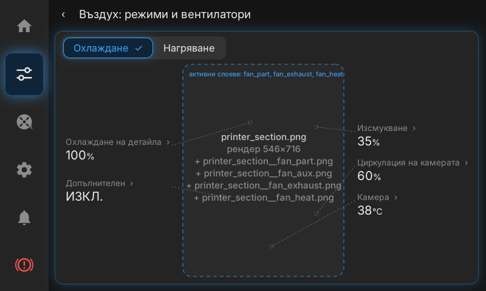 |
| 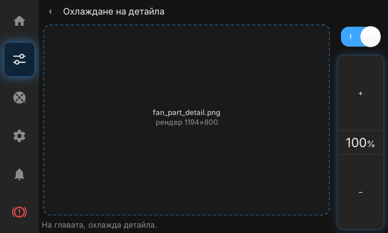 | 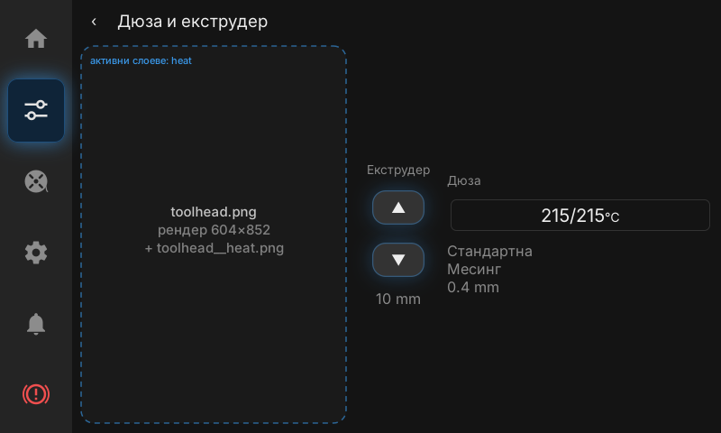 | 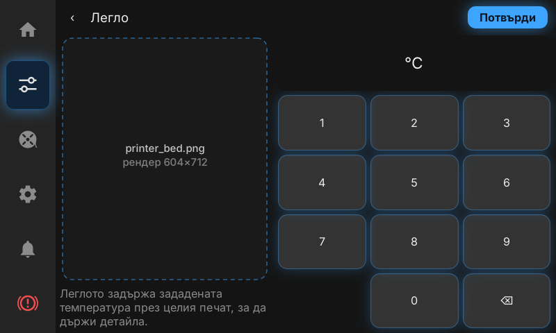 |
| 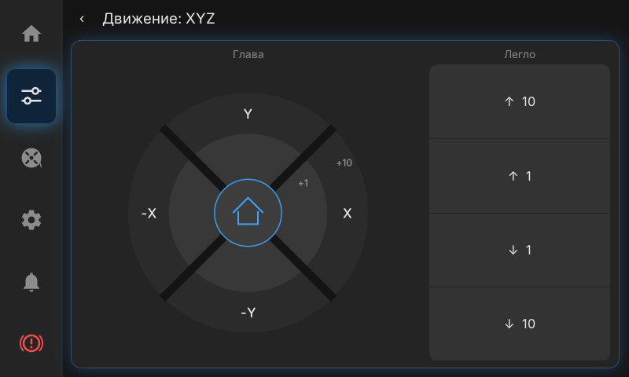 | 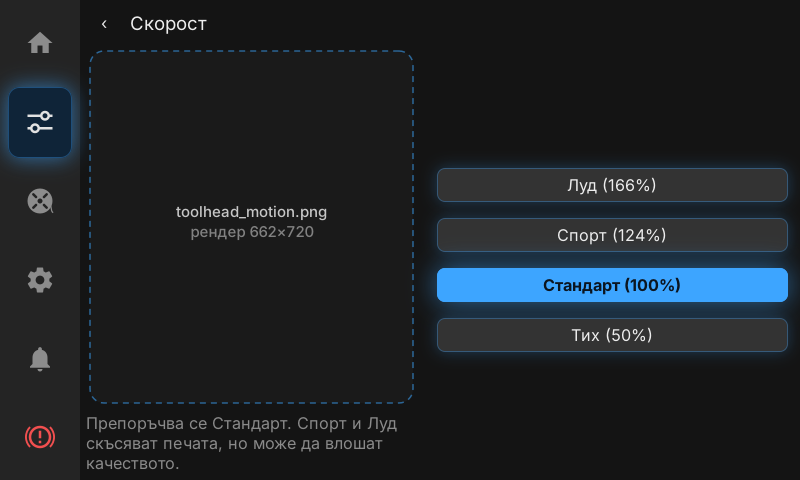 | 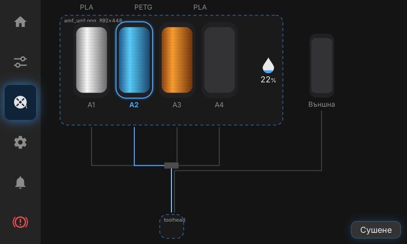 |
| 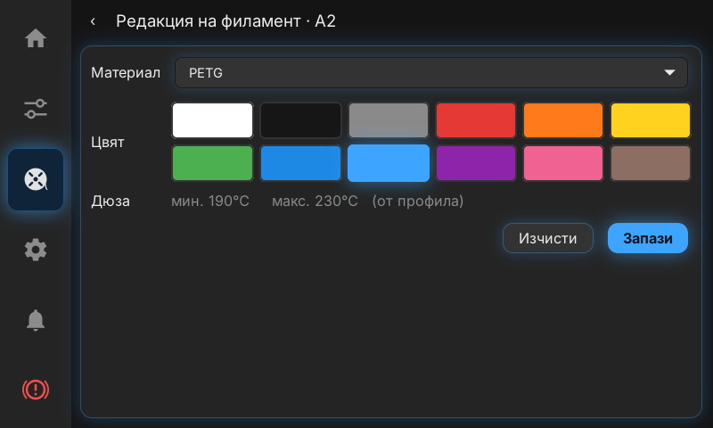 | 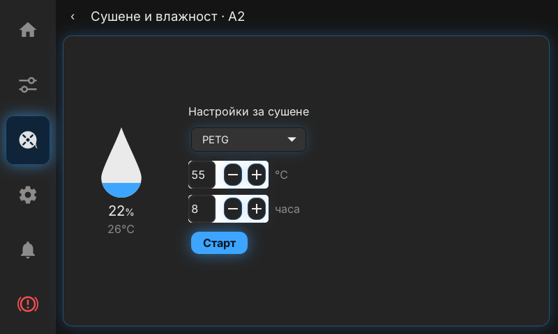 | 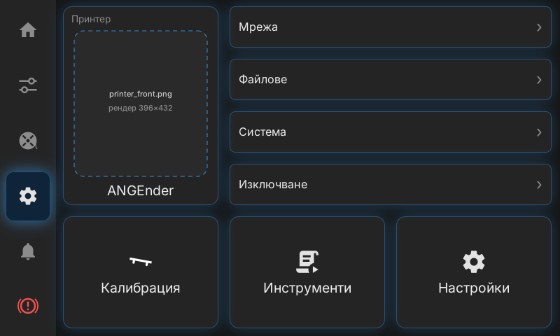 |
| 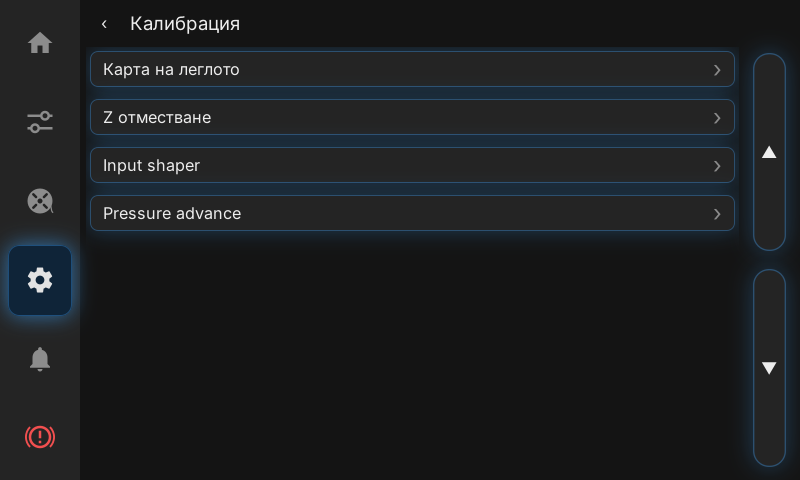 | 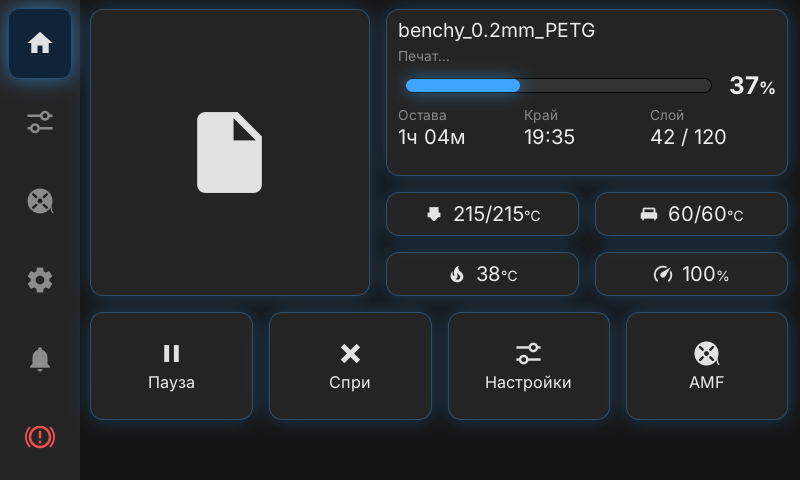 | |

Прегенериране (нужни са GTK3, python3-gi-cairo и Xvfb):

```bash
xvfb-run -a -s "-screen 0 800x480x24" python3 tools/preview_pages.py ~/KlipperScreen $PWD $PWD/docs/preview
```

## Инсталация
На Raspberry Pi-то с KlipperScreen:

```bash
cd ~ && git clone https://github.com/ageorgiev86/ANG_Ender_screen.git
```

```bash
~/ANG_Ender_screen/install.sh
```

След това в KlipperScreen:
1. **Settings → Icon Theme → ang-bambu**
2. **Settings → Enable Add-ons** (включи), после рестартирай KlipperScreen

Препоръчително за 800×480 в `KlipperScreen.conf`, секция `[main]`:

```ini
theme: ang-bambu
font_size: small
enable_addons: True
```

Обновяване:

```bash
cd ~/ANG_Ender_screen && git pull
```

## План
- [x] Тема: цветове и форми
- [ ] Собствени икони в стил Bambu
- [x] Изчистен начален екран
- [x] Страници за управление, AMF и устройство (чакат рендерите)
- [ ] Изпробване на истинския принтер и включване на екрана по време на печат
- [ ] Плочки за температури и вентилатори

## Лиценз
AGPL-3.0, както KlipperScreen (иконите са производни на темата material-dark).
