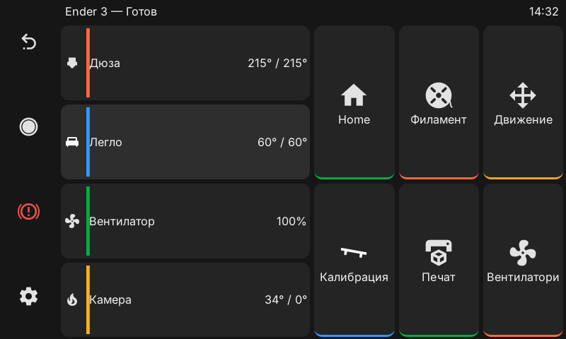
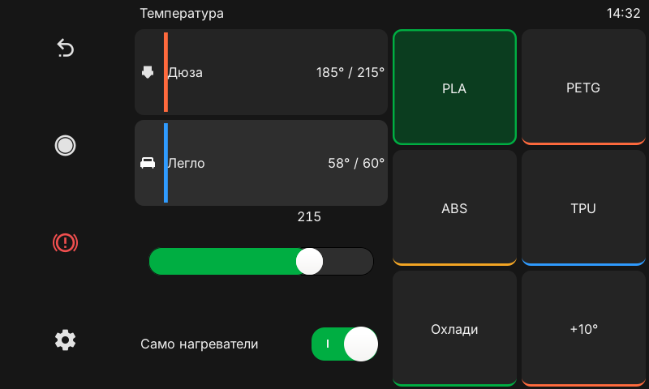

# ANG_Ender_screen

Нов потребителски интерфейс (тема) за [KlipperScreen](https://github.com/KlipperScreen/KlipperScreen), вдъхновен от изчистения стил на Bambu Lab принтерите.

Целеви екран: **4.3" 800×480 HDMI тъч екран**.

## Какво има в момента
**Тема `ang-bambu`** (`styles/ang-bambu/`):
- тъмен фон, неутрални „карти“ със заоблени ъгли
- зелен акцент `#00AE42` за активни елементи, прогрес и превключватели
- цветни черти под бутоните вместо цветни рамки (оранжево — дюза, синьо — легло)
- цветове на графиките в `style.conf`
- иконите засега са от `material-dark` и ще бъдат заменени

## Как изглежда
Снимки 800×480 с реалния GTK CSS на темата. Разположението е приблизително, не са снимки от истински KlipperScreen.

| Главно меню | Печат | Температура |
|---|---|---|
|  |  |  |

Прегенериране (нужни са GTK3 и Xvfb):

```bash
xvfb-run -a -s "-screen 0 800x480x24" python3 tools/preview.py ~/KlipperScreen/styles/base.css $PWD/styles/ang-bambu $PWD/docs/preview
```

## Инсталация
На Raspberry Pi-то с KlipperScreen:

```bash
cd ~ && git clone https://github.com/ageorgiev86/ANG_Ender_screen.git
```

```bash
~/ANG_Ender_screen/install.sh
```

След това: **Settings → Icon Theme → ang-bambu**.

Препоръчително за 800×480 в `KlipperScreen.conf`, секция `[main]`:

```ini
theme: ang-bambu
font_size: small
```

Обновяване:

```bash
cd ~/ANG_Ender_screen && git pull
```

## План
- [x] Тема: цветове и форми
- [ ] Собствени икони в стил Bambu
- [ ] Нов главен панел: голям преглед на печата (миниатюра, прогрес, оставащо време, слой)
- [ ] Плочки за температури и вентилатори

## Лиценз
AGPL-3.0, както KlipperScreen (иконите са производни на темата material-dark).
